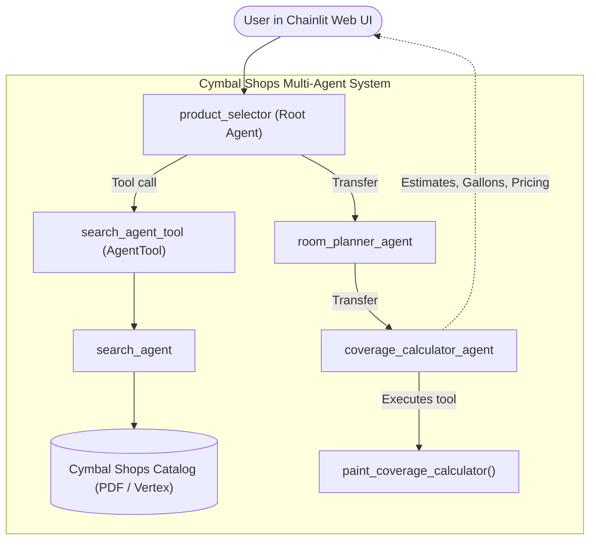

# Google ADK Cookbook: Multi-Agent AI Systems & Architectures

A hands-on, production-ready guide to building autonomous AI agents and multi-agent systems using the **Google Agent Development Kit (ADK)** and **Gemini**.

This repository is designed as a progressive curriculum: starting from a minimal single-file agent ("Hello World"), advancing through tool integrations, custom workflows, supervisor-auditor pipelines, and open protocols (MCP and A2A), and culminating in a full-stack multi-agent application with a web UI.

---

## 🗺️ How to Read This Project

The repository is structured in a clear progression. Follow the numbered directories in order to understand how each agentic concept builds upon the previous one:

```
[01_foundation_agents]      ──►  [02_tool_agents]        ──►  [03_workflow_agents]
   • first_agent (Hello World)      • function_tool_agent        • loop_agent (Iterative loops)
   • app_agent (Runner & State)     • langchain_tool_agent       • parent_and_subagents (Delegation)
                                    • crewai_tool_agent
                                    • my_google_search_agent
                                    • vertexai_search_tool_agent
                                               │
                                               ▼
[06_a2a_protocol_agents]    ◄──  [05_mcp_agents]         ◄──  [04_supervisor_agent]
   • slide_content_agent            • adk_mcp_server (FastMCP)   • critic & reviser
   • illustration_agent             • google_maps_mcp client       (Sequential auditor pipeline)
          │
          ▼
[07_agent_evaluation]       ──►  [08_agent_engine_deploy]──►  [09_multi_agent_application]
   • Faithfulness & relevance       • Cloud packaging & Vertex   • Cymbal Shops paint_agent
   • Evaluation notebooks             Reasoning Engine             • Chainlit Web UI Frontend
```

### Module Breakdown

| Folder | Core Concepts Demonstrated | What to Inspect First | Run Command |
| :--- | :--- | :--- | :--- |
| **`01_foundation_agents`** | **Hello World & State**: Minimal `LlmAgent`, model binding, prompt-response cycles, and managing chat sessions with `InMemoryRunner`. | `01_foundation_agents/first_agent/agent.py` | `make run-agent AGENT=first_agent` |
| **`02_tool_agents`** | **Tool Calling & Grounding**: Equipping agents with Python functions, LangChain tools (`Wikipedia`), CrewAI scrapers, live Google Search, and enterprise document RAG. | `02_tool_agents/function_tool_agent/agent.py` | `make run-agent AGENT=function_tool_agent` |
| **`03_workflow_agents`** | **Control Flow & Delegation**: Iterative feedback cycles with `LoopAgent` and hierarchical delegation where a parent orchestrator delegates subtasks to specialized children. | `03_workflow_agents/parent_and_subagents/agent.py` | `make run-agent AGENT=parent_and_subagents` |
| **`04_supervisor_agent`** | **Supervisor / Auditor Pipeline**: A 3-stage `SequentialAgent` pipeline (`Draft -> Critic -> Reviser`) simulating automated code/content review with web fact-checking. | `04_supervisor_agent/agent.py` | `make run-agent AGENT=04_supervisor_agent` |
| **`05_mcp_agents`** | **Model Context Protocol (MCP)**: Exposing ADK tools via an MCP server (`FastMCP`) and consuming external MCP services (e.g., Google Maps) as an MCP client. | `05_mcp_agents/adk_mcp_server/agent.py` | `make run-agent AGENT=adk_mcp_server` |
| **`06_a2a_protocol_agents`** | **Agent-to-Agent (A2A) Protocol**: Microservice agents running across process boundaries and interacting via standardized Agent Cards (`agent.json`). | `06_a2a_protocol_agents/slide_content_agent/agent.py` | `make run-agent AGENT=slide_content_agent` |
| **`07_agent_evaluation`** | **Agent Benchmarking & Testing**: Measuring hallucination rates, faithfulness, and answer relevance using ADK evaluation metrics. | `07_agent_evaluation/evaluating_adk_agent-v1.1.0 (1).ipynb` | Open in VS Code / Jupyter |
| **`08_agent_engine_deployment`** | **Cloud Deployment**: Packaging and deploying ADK agents as managed reasoning engines on Vertex AI. | `08_agent_engine_deployment/query_agent_engine.py` | `python 08_agent_engine_deployment/query_agent_engine.py` |
| **`09_multi_agent_application`** | **Full-Stack Capstone Application**: End-to-end multi-agent customer paint assistant featuring catalog search, room planning, surface calculation, and an interactive Chainlit Web UI. | `09_multi_agent_application/paint_agent/agent.py` | `make run-ui` |

---

## ⚙️ Prerequisites & Setup

### 1. Requirements
* **Python**: `3.10`, `3.11`, or `3.12`
* **Google Gemini API Key**: Free key from [Google AI Studio](https://aistudio.google.com/)
* **Make** (optional, recommended): Pre-installed on Linux/macOS; available on Windows via Chocolatey (`choco install make`) or Scoop.

---

### 2. Step-by-Step Installation

#### Step 1: Clone the Repository
```bash
git clone https://github.com/<your-username>/google-adk-cookbook.git
cd google-adk-cookbook
```

#### Step 2: Configure Environment Variables
Create a `.env` file in the project root:
```bash
# On Linux/macOS:
cp .env.example .env

# On Windows PowerShell:
Copy-Item .env.example .env
```

Open `.env` and set your Google Gemini API key:
```env
# 100% Free Tier Configuration (Zero Cloud Charges)
GOOGLE_GENAI_USE_VERTEXAI=FALSE
GOOGLE_API_KEY=your_gemini_api_key_here
MODEL=gemini-2.0-flash
```

> **Zero Cloud Billing Note**: Setting `GOOGLE_GENAI_USE_VERTEXAI=FALSE` runs all agents directly against Google AI Studio free tier (15 RPM / 1M TPM) without needing Google Cloud Application Default Credentials (ADC) or billing accounts.

#### Step 3: Create Virtual Environment & Install Dependencies

**Using Make (Recommended - Windows & Linux):**
```bash
make venv
make install
```

**Or Using Standard Python / Pip:**

*On Windows (PowerShell):*
```powershell
python -m venv .venv
.venv\Scripts\Activate.ps1
pip install -e .
```

*On Linux / macOS:*
```bash
python3 -m venv .venv
source .venv/bin/activate
pip install -e .
```

#### Step 4: Verify Your Installation
Verify that all packages and dependencies are correctly installed:
```bash
make check
```

---

## 🚀 Execution Guide

### 1. Run the Full-Stack Chainlit Web UI (Capstone)
Launch the interactive Cymbal Shops Paint Assistant web application:
```bash
make run-ui
```
Open your browser at **`http://localhost:8000`**.



---

### 2. Run Individual Agents
You can execute any agent by name using the `make run-agent` target:

```bash
# Foundation Agent (Hello World)
make run-agent AGENT=first_agent

# Tool Agent with Custom Python Functions
make run-agent AGENT=function_tool_agent

# LangChain Wikipedia Tool Agent
make run-agent AGENT=langchain_tool_agent

# Web Scraping Agent (CrewAI ScrapeWebsiteTool)
make run-agent AGENT=crewai_tool_agent

# Grounded Web Search Agent
make run-agent AGENT=my_google_search_agent

# Workflow Agents (Iterative Loop & Parent-Subagent delegation)
make run-agent AGENT=loop_agent
make run-agent AGENT=parent_and_subagents

# Multi-Agent Sequential Supervisor (Draft -> Critic -> Reviser)
make run-agent AGENT=04_supervisor_agent

# Model Context Protocol (MCP) Server & Client
make run-agent AGENT=adk_mcp_server
make run-agent AGENT=google_maps_mcp_agent

# Agent-to-Agent (A2A) Microservices
make run-agent AGENT=slide_content_agent
```

*Alternative (Direct Python Execution):*
```bash
# Windows
.venv\Scripts\python 01_foundation_agents\app_agent\agent.py

# Linux / macOS
.venv/bin/python 01_foundation_agents/app_agent/agent.py
```

---

### 3. Run the ADK Web Playground
To test and inspect agent reasoning and function calling in Google's official visual playground:
```bash
# Interactively choose a module (1-7):
make run-web

# Or specify a directory directly:
make run-web DIR=01_foundation_agents
make run-web DIR=02_tool_agents
make run-web DIR=03_workflow_agents
make run-web DIR=04_supervisor_agent
make run-web DIR=05_mcp_agents
make run-web DIR=06_a2a_protocol_agents
make run-web DIR=09_multi_agent_application
```

---

## 📋 Complete Makefile Reference

| Target | Description |
| :--- | :--- |
| `make help` | Show all available commands and descriptions. |
| `make venv` | Create `.venv` virtual environment cross-platform. |
| `make install` | Install all dependencies declared in `pyproject.toml`. |
| `make check` | Run `pip check` to verify dependency consistency. |
| `make run-ui` | Start the Chainlit web UI on `http://localhost:8000`. |
| `make run-agent AGENT=<name>` | Run an individual agent by name in the terminal. |
| `make run-web [DIR=...]` | Launch the ADK visual web playground. |
| `make clean` | Remove temporary cache files, `.pytest_cache`, and `__pycache__`. |

---

## 📁 Repository Structure

```
google-adk-cookbook/
├── 01_foundation_agents/         # Minimal agents, Runners, Sessions, and Callbacks
├── 02_tool_agents/               # Python functions, LangChain, CrewAI, Google & Vertex Search
├── 03_workflow_agents/           # LoopAgent (iterative) & Parent-Subagent delegation
├── 04_supervisor_agent/          # Sequential pipeline: Drafter -> Critic -> Reviser
├── 05_mcp_agents/                # FastMCP server & Google Maps MCP client
├── 06_a2a_protocol_agents/       # Agent-to-Agent protocol microservices & Agent Cards
├── 07_agent_evaluation/          # Evaluation notebooks (faithfulness, hallucination, relevance)
├── 08_agent_engine_deployment/   # Cloud packaging for Vertex AI Reasoning Engines
├── 09_multi_agent_application/   # Capstone paint assistant & Chainlit Web UI
├── docs/                         # Catalog datasheets & documentation
├── Makefile                      # Cross-platform automation (Windows & Linux)
├── pyproject.toml                # Single source of truth for project dependencies
├── .env.example                  # Environment variable configuration template
└── README.md                     # Project documentation & execution guide
```

---

## 📄 License & Attribution

This project is open-source. You are free to adapt, modify, and build upon these agent patterns for personal or commercial applications.
